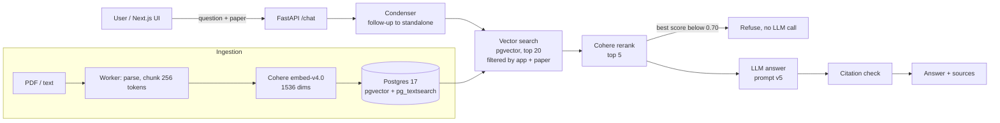

# Paper QA RAG

Ask questions about research papers and get answers that cite the exact passage they come from, or a clear "not in this paper" when the answer isn't there.

Think "NotebookLM for papers": you upload a paper (PDF or text), pick it, and ask. Every claim in the answer links back to a numbered source chunk. If the paper doesn't contain the answer, the system says so instead of guessing. Both behaviours are measured on two public benchmarks (see [Evaluation](#evaluation-retrieval)).

> Status: personal portfolio project, under active development. Numbers below come from real runs with free-tier models; each one has a 95% confidence interval.

## What it does

- **Grounded answers with citations.** Answers cite `[Source n]`, and invalid citation numbers are removed before the answer is returned.
- **Two refusal layers.** The first is a rerank-score threshold, which refuses without calling the LLM. The second is a prompt rule that makes the LLM refuse when the sources are insufficient.
- **Paper mode.** Retrieval is restricted to the chosen paper(s) via a `document_ids` filter. The same API also searches a whole library.
- **Multi-application isolation.** Each application (collection) has its own documents, chunks and keyword index; queries never cross applications.
- **Chat with history.** A condenser rewrites follow-up questions into standalone ones.
- **Web UI.** Next.js frontend with session sidebar, light/dark theme.
- **Production basics.** API-key auth, rate limiting, background ingestion with retries, JSON logs, Prometheus metrics, Caddy HTTPS deploy, GitHub Actions CI.

## Architecture



| Layer | Choice | Why |
|---|---|---|
| API | FastAPI | async, typed, OpenAPI out of the box |
| Storage | Postgres 17 + pgvector (HNSW) + pg_textsearch (BM25) | one database for documents, vectors and keyword search |
| Embedding | Cohere `embed-v4.0`, 1536 dims | strong on scientific English |
| Rerank | Cohere `rerank-v4.0-pro` | the largest single gain in the evaluation |
| LLM | OpenAI-compatible client (OpenRouter, Groq, NVIDIA NIM) | provider is a setting, not code |
| Frontend | Next.js + TypeScript | |
| Ops | Docker Compose, Caddy, GitHub Actions, Prometheus | |

Retrieval mode (`vector`, `keyword`, `hybrid`), keyword ranking, RRF weight, chunking strategy, rerank threshold and answer prompt are all settings, so each can be A/B tested without code changes.

## Quick start

Requirements: Docker, a Cohere API key, and an LLM key (OpenRouter, Groq or NVIDIA).

```bash
git clone <this repo> && cd rag_portfolio
cp .env.example .env          # fill in the API keys; never commit .env
docker compose up -d --build
docker compose exec backend alembic upgrade head
```

- Web UI: http://localhost:3000
- API docs (dev only): http://localhost:8000/docs

Ingest a folder of text files into an application:

```bash
docker compose exec backend sh -c 'python scripts/ingest.py --app mypapers --app-name "My papers" eval/qasper/docs/*.txt --show 0'
```

Run the tests:

```bash
docker compose exec backend pytest -q
```

<!-- TODO duc: check ports, the alembic command and the frontend test command against your docker-compose.yml -->

## Evaluation: Retrieval

**Setting.** The user picks a paper and asks questions about it (like NotebookLM). Retrieval is restricted to the chunks of that paper (`--scope paper`), which is also how QASPER and PeerQA define the task. The paper title is removed from the question, so the system cannot cheat by matching the title.

**Datasets**

| Dataset | Role | Papers | Chunks | Questions scored | Gold evidence |
|---|---|---|---|---|---|
| [QASPER](https://allenai.org/data/qasper) (dev, CC BY 4.0) | choose the configuration | 60 | 1,740 (~29 / paper) | 160 | annotated evidence paragraphs |
| [PeerQA](https://github.com/UKPLab/peerqa) (nlpeer + egu, not redistributed) | confirm on a second dataset, no re-tuning | 90 | 3,885 (~43 / paper) | 136 | annotated evidence paragraphs |

A chunk counts as relevant if it contains a gold evidence paragraph. Chunking: 256 tokens, overlap 40. Embedding: Cohere `embed-v4.0` (1536 dims). Keyword: BM25 via `pg_textsearch` on Postgres 17. Hybrid: RRF (k = 60). Rerank: Cohere `rerank-v4.0-pro` over the top 20 candidates. All runs use the same questions; 95% CIs come from bootstrap over questions.

**Decision rule, written before running:** pick the configuration with the best hit@5 on QASPER, then keep it on PeerQA only if (1) it is ≥ vector at hit@5 and (2) hybrid is not clearly better than vector.

### Results

| Method | QASPER hit@1 | QASPER hit@5 | QASPER MRR@5 | PeerQA hit@1 | PeerQA hit@5 | PeerQA MRR@5 |
|---|---|---|---|---|---|---|
| random chunk (baseline) | .08 | .35 | | .04 | .18 | |
| keyword (BM25) | .24 | .69 | .40 | .36 | .67 | .47 |
| vector | .40 [.32–.47] | .78 [.71–.84] | .54 | .33 [.25–.41] | .68 [.60–.76] | .46 |
| hybrid (RRF) | .36 | .78 | .51 | .33 | .70 | .47 |
| hybrid → rerank | .43 | .84 | .58 | .49 | .83 | .62 |
| **vector → rerank (chosen)** | **.44** [.37–.52] | **.84** [.78–.89] | **.59** | **.50** [.42–.59] | **.84** [.77–.90] | **.62** |

Random chunk = expected hit@k when k chunks are drawn uniformly from the paper, computed analytically (QASPER likewise reports a random-paragraph baseline, Dasigi et al., 2021, Table 3).

Rerank latency (Cohere API): p50 0.5 s, p95 1.3–2.8 s. Retrieval without rerank: under 30 ms.

### What we learned

- **Reranking is the biggest win.** Per question against vector, on PeerQA rerank fixed 24 questions and broke 3 at top 5 (QASPER: 20 vs 10).
- **Hybrid search did not help.** On both datasets hybrid ties with vector (PeerQA top 5: 12 questions gained, 10 lost). After reranking, hybrid → rerank equals vector → rerank within 1–3 questions, because inside one paper both candidate pools of 20 overlap almost completely. We keep the simpler pipeline.
- **The configuration chosen on QASPER held up on PeerQA without changes** (hit@5 .84 on both).

### Limitations

- About 1 in 6 questions still has no relevant chunk in the top 5 (QASPER 26, PeerQA 22). Common causes: yes/no questions, questions needing a whole section, and numbers that only appear in tables.
- PeerQA's official setup ranks each paragraph without chunking. We chunk by size, so our numbers are not directly comparable to the paper's leaderboard.
- The questions come from public benchmarks, not real users of this app.

### Reproduce

```bash
docker compose exec -e RETRIEVAL_MODE=vector -e KEYWORD_RANKING=pg_textsearch backend \
  python scripts/evaluate_retrieval.py --app qasper --dataset eval/dataset_qasper.json \
  --scope paper -k 1 3 5 --rerank-from vector hybrid --sleep 14
```

Each run writes a JSON report and an Excel file (per-question ranks, CIs, config snapshot) to `eval/results/`.

## Evaluation: Answer generation

**Setting.** Same paper mode and retrieval (vector → rerank, top 5 chunks to the LLM). Answer prompt v5; answer model `nvidia/nemotron-3-ultra` (OpenRouter free tier). A question is refused if the best rerank score is below 0.70 (threshold) or if the LLM says the sources are insufficient.

Two question types are scored separately:
- **Answerable** questions: does it answer, is the answer grounded, does it cite the right chunk?
- **Unanswerable ("trap")** questions: the paper is loaded but does not contain the answer. Does it refuse?

**Decision rule, written before running:** block ≥ 14/17 QASPER traps and wrongly refuse ≤ 6/32 answerable questions.

### Results

| Metric | QASPER | PeerQA |
|---|---|---|
| **Traps refused** | **13/17 = .76** [.53–.94] | **35/46 = .76** [.63–.87] |
| – blocked by the rerank threshold | 6 | 5 |
| – refused by the LLM | 7 | 30 |
| – traps with ≥ 2 annotators who all marked "unanswerable" | **8/8** | |
| – traps labelled by a single annotator | 5/9 | |
| – F1000 papers (text includes the peer-review section) | | 2/10 |
| – all other papers | | 33/36 |
| **Answerable: wrongly refused** | **5/32 = .16** [.03–.28] | **13/32 = .41** [.25–.56] |
| Faithfulness (LLM judge, answered questions) | .95 [.89–.99] | .97 |
| Citation hit (cites a gold-evidence chunk) | .81 [.67–.96] | .84 |
| Answer recall / SQuAD-style F1 | .63 / .30 | .21 / .12 |
| Latency p50 / p95 (answerable, end to end) | 10.6 s / 39 s | 8.2 s / 24 s |

### What we learned

- **The two refusal layers complement each other.** The threshold stops questions where the paper has nothing relevant (scores .54–.68) without calling the LLM; the prompt catches questions with look-alike chunks (scores .73–.93).
- **The threshold sits in a real gap.** Every blocked trap scored ≤ .68 and the lowest answerable question scored .76, so 0.70 was kept. The four traps that were answered scored .87–.95; no threshold could block them without also refusing real answers.
- **Trap failures track label quality.** QASPER reports 90% answerability agreement overall (Dasigi et al., 2021), but in the dev set, of the 101 multi-annotated questions with at least one "unanswerable" vote, 74% had another annotator who answered it. All 4 answered traps had a single annotator; none of the 8 traps that two annotators agreed on was answered. The split rule uses only QASPER's labels, not our outputs, and we report both rows. (n is small: a trend, not a statistical result.)
- **Manual review of the 4 answered "traps": 3 are answered in the paper, 1 is partly wrong.** Each had a single QASPER annotator who marked it unanswerable (e.g. *"What features are used?"* in a paper titled *"…using TF-IDF Features"*). The partly wrong one quotes a real number (79% recall) from a side experiment as the method's performance. We report the raw 13/17 by the original labels.
- **The main weakness is over-caution on list questions.** Of the 5 wrong refusals: 2 are clear LLM misses (the answer was in the top-ranked chunk, or a numbered list split across chunks); 1 needs tag names that QASPER replaced with a formula placeholder; 1 is only answerable from a table body, which QASPER's text does not include (refusing was correct for our input); 1 is a retrieval miss (the reranker pushed the correct chunk, vector rank 1, out of the top 5).
- **PeerQA trap failures come from the input text, not from invention.** In PeerQA the text of F1000 papers includes the reviewer reports and the authors' responses, so a reviewer's question can be answered by the authors' own reply: 7 of the 11 answered traps quoted that text, and 1 more is answered in the article body. On the other 36 papers, 33 traps were refused; 2 of the 3 answered ones are stated in the camera-ready text. *(Planned: remove the peer-review section from these 4 papers and re-run; both numbers will be reported. In a real product, answering from a review that is part of the uploaded PDF is fine, as long as the answer says it comes from the review.)*
- **PeerQA is harder for answerable questions** (13/32 wrongly refused). Of the 13: 6 are retrieval misses, 5 had the gold chunk in the top 5 but the LLM refused (reference answers are written freely by the paper authors, often longer than any one passage), and 2 were blocked by the threshold with the gold chunk at rank 1–2 (scores .58 and .64). Lowering the threshold to save those 2 would pass 7 more traps to the LLM across both datasets, so 0.70 was kept.
- **Low F1 is expected on QASPER**: answers are full sentences while the references are short spans.

### Limitations

- Small trap set (17), hence the wide CI; PeerQA adds 46 more, labelled by the papers' own authors.
- QASPER's text has table captions but not table bodies, and formulas appear as `INLINEFORM` placeholders.
- The faithfulness judge failed on 6 of 27 answered questions (5 ran out of output tokens while reasoning, 1 connection error); faithfulness is computed on the remaining 21. Manual review of every NO verdict against the stored context: 4 of 5 "unsupported" claims were in fact stated in the context (the judge is strict on paraphrases); 1 was a real unsupported inference (qa058). Reviewed faithfulness ≈ .99.
- Citation hit is strict: 3 answers were correct but cited a different passage that states the same fact.
- Free-tier model: latency varies with load.

## Data and licences

- **QASPER** (Dasigi et al., NAACL 2021), CC BY 4.0. The dev subset used here can be regenerated with `scripts/import_qasper.py`.
- **PeerQA** (Baumgärtner et al., NAACL 2025), not redistributed here. Download it from the [official repo](https://github.com/UKPLab/peerqa) and run `scripts/import_peerqa.py`.
- No API keys, `.env`, PeerQA texts or result spreadsheets are committed.

## Roadmap

- PeerQA re-run with the peer-review sections removed.
- Chunking A/B: fixed 256 tokens vs paragraph/section chunks.
- Prompt v6 for list questions and partial answers (main cause of wrong refusals).
- Full-paper-in-context baseline vs RAG.
- Test on real PDFs (not benchmark text).
