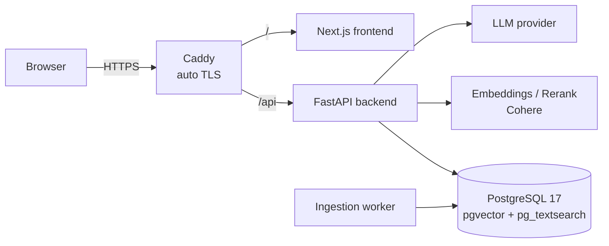

# RAG Chatbot for CV & Research Papers

**Live demo:** https://minhduc-rag.duckdns.org (no login needed)

A production-style Retrieval-Augmented Generation system: upload documents (PDF, DOCX, TXT), then chat with them.
Every answer cites the passages it came from, and the bot declines to answer when the documents don't contain the answer.

## Try it

The public `qasper` app holds 60 NLP research papers from the [QASPER](https://allenai.org/data/qasper) dataset.
These are the same papers used in the retrieval evaluation. Pick `qasper` in the app selector and ask:

| Question | Expected behaviour |
|---|---|
| In the paper 'Deep Learning the EEG Manifold for Phonological Categorization from Active Thoughts': How many subjects does the EEG data come from? | Answers **14**, with citations |
| In the paper 'Word2Vec: Optimal Hyper-Parameters and Their Impact on NLP Downstream Tasks': What Named Entity Recognition dataset is used? | Answers **Groningen Meaning Bank (GMB)**, with citations |
| In the paper 'Automatic Classification of Pathology Reports using TF-IDF Features': How many annotators participated? | **Refuses**: the paper does not say |
| Who won the 2022 FIFA World Cup? | **Refuses**: outside the documents |

Click a citation to see the exact passage the answer came from. Asking the same question twice returns the cached answer instantly (marked ⚡).
The demo is rate-limited (10 questions per minute).

## Features

- **Hybrid retrieval**: vector search (pgvector) + BM25 keyword search (pg_textsearch), merged with Reciprocal Rank Fusion
- **Reranking** with Cohere Rerank, plus a minimum-score threshold so the bot abstains instead of guessing
- **Answers with citations**: each claim links back to the source chunk
- **Chat sessions** with follow-up question condensing (“what about the second one?” becomes a standalone query)
- **Multi-tenant applications**: each app has its own document set; public or private, with viewer/editor roles
- **Background ingestion**: a worker parses, chunks and embeds uploads with retries
- **Security**: JWT auth, rate limiting per user/IP, strict CORS, security headers, hidden API docs in production
- **Performance**: answer cache keyed on question, corpus and config; in-memory query-embedding cache
- **Observability**: structured JSON logs with request IDs, Prometheus metrics and alert rules
- **Evaluation**: retrieval metrics (Recall@k, MRR, nDCG) and LLM-judged faithfulness on SQuAD, QASPER and PeerQA

## Architecture



## Tech stack

| Layer | Tools |
|---|---|
| Backend | Python 3.11, FastAPI, SQLAlchemy 2, Alembic |
| Database | PostgreSQL 17, pgvector, pg_textsearch (BM25) |
| AI | Cohere embed-v4.0 and rerank, pluggable LLM providers (OpenRouter, NVIDIA, Groq, Gemini) |
| Frontend | Next.js 16, React 19, Tailwind CSS 4 |
| Ops | Docker Compose, Caddy, Prometheus, AWS EC2 |
| Tests | pytest (530+ tests), Vitest |

## Run locally

```bash
cp .env.example .env          # fill in your API keys
docker compose up -d --build
docker compose exec backend python scripts/manage_users.py create-user you@example.com --superadmin
```

- Frontend: http://localhost:3000
- API docs: http://localhost:8000/docs

Run the tests:

```bash
docker compose exec backend pytest -q
```

## Deploy

Production runs on one VPS with `docker-compose.prod.yml`. Only Caddy is exposed (ports 80/443), and it gets HTTPS certificates automatically.

```bash
cp .env.prod.example .env      # set DOMAIN, secrets, provider keys
docker compose up -d --build
python scripts/check_deploy.py https://your-domain   # checks HTTPS, headers, auth, open ports from outside
```

Nightly backups: `deploy/backup.sh`. Restore test: `deploy/restore_check.sh`.
